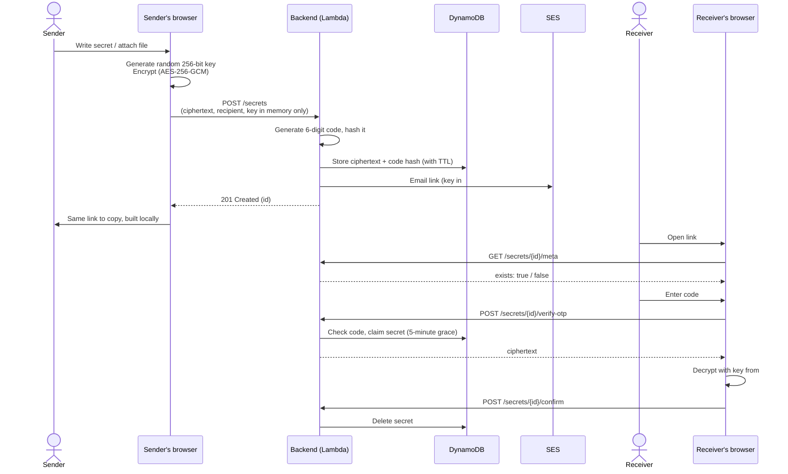

# SecretShare design

This document explains how SecretShare works and why it's built the way it is. It's for
anyone evaluating, deploying or contributing to the project. To get it running, see
[deployment.md](deployment.md).

## Goals

- Share a secret without leaving a readable copy anywhere: not in email, not in chat,
  not in logs, not in the server's database.
- Record who sent something to whom and whether it was opened, without being able to
  see what was sent.
- Be cheap and simple to run yourself: serverless, a few dollars a month, one Terraform
  stack.

## Non-goals

- A hosted multi-tenant service. Each organization runs its own copy.
- Large file transfer. Files are capped at 150 KB.
- Protection from whoever controls the deployment. As with any browser-based
  encryption tool, users trust the JavaScript the site serves. An operator who changes
  the frontend or the Lambda code could capture secrets.

## Components

| Piece | AWS service | Notes |
|---|---|---|
| Frontend | S3 (private) + CloudFront | Static single-page app behind Origin Access Control, strict security headers |
| API | API Gateway HTTP API | JWT authorizer on sender routes, throttled to 10 requests/s (burst 20) |
| Backend | One Lambda function, Node.js 24 | Every route is handled by `src/index.ts` |
| Schedule | EventBridge rule | Runs the monthly admin summary |
| Sign-in | Cognito user pool + hosted UI | OIDC federation, native accounts, optional TOTP |
| Email | SES | One verified sender address |
| Data | Four DynamoDB tables | `secrets`, `roles`, `audit`, `settings` |
| Alerts | CloudWatch, SNS, AWS Budgets | Lambda errors, SES bounces and complaints, monthly spend |

There's no server-side session store, cache or queue. The tables and Cognito hold all
the state.

## A secret's lifecycle

## Encryption

- The sender's browser creates a random 32-byte key and a 12-byte IV, and encrypts with
  AES-256-GCM through the Web Crypto API. There's no third-party crypto library.
- The key goes in the URL fragment. Browsers never send the fragment to a server, so it
  never appears in a server log, the database or a CloudFront access log. The page also
  sets `Referrer-Policy: no-referrer`.
- The secrets table holds only ciphertext, IV, timestamps and a hash of the access code.
  It never stores the plaintext or the key.

**The one trade-off.** The server sends the email, so it has to build the link, which
contains the key. The sender's browser passes the key to the Lambda function once, in
memory. It's used to write the email and is never stored or logged. During that single
call the backend could see the key, the same way your bank knows the one-time code it
just texted you. If that's not acceptable, the alternative is for senders to deliver the
link themselves. Earlier versions did that (see [History](#history)).

## The access code is a gate, not a key

Each secret gets a 6-digit code, sent in the same email as the link and checked by the
server before it releases anything.

- It's hashed with scrypt and a random per-secret salt, and compared in constant time.
- It's valid for 10 minutes, separate from the secret's own lifetime. A receiver whose
  code has expired clicks **Resend**.
- 5 wrong attempts destroy the secret.
- Resend works at most 2 times, with a 60-second cooldown. Each new code invalidates the
  previous one.
- It stops corporate mail scanners from "opening" a secret by prefetching the link.

Deriving the encryption key from the code would look like extra protection, but it would
weaken the design. A 6-digit code has only a million possibilities, so anyone holding
the ciphertext could brute-force it offline. The real key is always the independent
256-bit fragment key. The code only controls whether the server releases the
ciphertext.

## Burn after read

The server can't know whether decryption worked in the browser, so it doesn't delete the
secret on the very first fetch. Instead:

1. The first correct code **claims** the secret and cuts its remaining life to a 5-minute
   grace window. A different claimant after that is refused.
2. Right after a successful decrypt, the browser calls `confirm` and the server deletes
   the secret. In practice it's gone within seconds.
3. If the confirm never arrives, the grace window expires it, and DynamoDB's TTL deletes
   it as a final backstop.

A sender can **revoke** a secret until it's claimed. Two independent checks apply: the
caller's email must match the sender recorded in the audit table, and the database
write is conditional on the secret not being claimed yet. Admins can't revoke on
someone else's behalf.

## Several recipients, and copying the link

A send can go to up to 10 people. The browser encrypts a separate copy for each one,
with its own key, and makes one `POST /secrets` call per recipient. Each person gets their
own link and code, so opening one copy doesn't touch the others, and each shows up as
its own row in history and the audit log. If one recipient fails, the rest still go out
and the page lists who didn't get it.

After sending, the sender sees each link with a **Copy** button, in case they also want
to share it in chat. The email still goes out as usual. The browser builds these links
from the keys it just generated, so nothing extra reaches the server, and they can't be
shown again later. The access code still goes only to the recipient's email, so a link
pasted somewhere it shouldn't be can't be opened on its own.

## File sharing

A file is wrapped in a small JSON envelope (`filename`, `mimeType`, base64 data) with a
fixed marker prefix, then encrypted exactly like text. After decrypting, the receiver's
page checks for the marker to decide whether to show text or offer a download. The
server can't tell a file from text.

The 150 KB cap comes from DynamoDB's 400 KB item limit. A file is base64-encoded twice
(once in the envelope, once as ciphertext), and the backend accepts at most 280,000
characters of ciphertext.

## Data model

**secrets** (key: `id`, a 128-bit random value): ciphertext, IV, `createdAt`,
`expiresAt` (the TTL attribute), `claimedAt`, the code's hash, salt, expiry and attempt
count, resend count and time, and the recipient's email (used only to resend the code).
Point-in-time recovery is **off** on purpose: "deleted" has to mean gone, and a backup
restore must not bring a burned secret back.

**roles** (key: `email`): `role` is `admin`. A user with no row is a normal user. The
table holds a few admin rows plus one bootstrap marker row. Point-in-time recovery is
on.

**audit** (key: `secretId`, plus a `sender-index` on `senderEmail` + `createdAt`):
sender, recipient, description, whether it was a file, whether to notify on open,
`createdAt`, the secret's expiry, and `claimedAt` / `confirmedAt` / `revokedAt`. Records expire after one year.
This table never holds the secret, a filename or the key. Point-in-time recovery is on,
because this one is meant to be a durable record.

**settings** (key: `id`): a single item holding the branding, sharing rules and report
settings, plus who changed them last and when. Point-in-time recovery is on.

## Sign-in and roles

Only senders sign in. Receivers never need an account.

- **Login flow.** The frontend uses the authorization code flow with PKCE against
  Cognito's hosted UI. There's no client secret in the browser. It sends the **ID
  token** as the bearer token, because Cognito access tokens don't carry the `email`
  claim. API Gateway's built-in JWT authorizer validates every token, so the Lambda has
  no token-verification code of its own.
- **Three ways to get an account**, all usable at once:
  - **SSO** through any OIDC provider. Configure it in Terraform or later from the
    Admin page, but not both: whichever runs last overwrites the other.
  - **Self-sign-up** with email and password. An admin can switch it on or off at
    runtime from the Admin page.
  - **Local accounts** created by an admin, for example for a contractor without SSO
    access. The temporary password is shown once and never stored.
- **MFA.** Native accounts can turn on TOTP. A device that passes an MFA challenge can
  be remembered. SSO logins skip this, because the identity provider has already
  authenticated the user.
- **First admin.** The first person to sign in on a new deployment becomes admin. A
  conditional write on a marker row makes this race-safe, so only one first login
  wins.
- **Promoting and demoting admins** happens on Admin → Users, with safeguards:
  - The admin must have signed in within the last 10 minutes. The ID token's
    `auth_time` claim records the real sign-in, and refreshing tokens doesn't change
    it, so an old stolen session can't do this.
  - You can't change your own role, and the last admin can't be removed.
  - Every admin, and the person affected, is emailed about each change, and the change
    is logged as `admin.role.changed`.
  - Demoting writes `role: "user"` instead of deleting the row, so the Lambda still has
    no delete access to the roles table. A routine `terraform apply` never changes who's
    an admin.
- **Removing users.** Removing a local account revokes access. Removing an SSO account
  only clears Cognito's copy, because the identity provider still decides who can sign
  in. You can't remove your own account. Removing an admin takes their role away first,
  with the same safeguards, so the admin row can't outlive the account.
- **History can't be deleted from the app.** The audit table is add-and-update only, so a
  stolen admin session can't erase what was shared. Rows expire after a year. To delete
  sooner, someone with AWS access runs the commands that Admin → Activity → **Reset**
  shows for a date range and/or sender.

## Admin page

Admins see the full activity log for a date range (last 30 days by default), a top
senders report, sign-in settings (SSO provider, self-sign-up, local accounts), the user
list, branding and sharing rules. The activity log downloads as CSV, with any cell that
could start a spreadsheet formula escaped. Regular users never see the Admin link, and
every admin endpoint checks the roles table on the server.

## Branding and sharing rules

**Branding** (the **Customize** tab) sets the theme, name, logo, support email and
footer note. Everyone sees it, including receivers. There are four themes, each a full
palette: **Obsidian** (black, brushed gold, crimson; the default), **Midnight** (navy, ice
blue, sapphire), **Racing green** (forest black, champagne, green) and **Heritage**
(graphite, powder blue, orange). Each keeps the same balance: the background carries most
of the page, a secondary color marks headings, links and thin lines, and the primary
color is kept for buttons and the active tab. All text meets WCAG AA contrast (4.5:1).
The colors live in `style.css` under `[data-theme]`. Adding a theme means one block
there, a logo in `public/logos/`, and its name in the theme lists in `settingsSchema.ts`
(backend) and `branding.ts` (frontend). In emails, the name is
the From display name and the support email appears at the bottom. The logo must be a PNG, JPEG, WebP or GIF of up to
100 KB, stored as a `data:` URL. SVG isn't accepted, because an SVG is a document that
can carry more than a picture. The frontend caches branding in local storage, so repeat
visits load already branded.

**Sharing rules** are checked by the backend on every send:

- **Allowed sender domains.** Signed-in users outside them can't send. Empty means
  anyone who can sign in. Set this when self-sign-up is open.
- **Allowed recipient domains.** Empty means any address.
- **Longest and default link lifetime.**
- **File attachments on or off.** This one is advisory. The server can't see inside the
  ciphertext, so it can only refuse sends that the app marks as files.

A domain also covers its subdomains: `example.com` allows `eu.example.com`, but not
`notexample.com`.

## Emails

The receiver's email names the sender's address, so they know who to expect it from.
A sender can tick **Email me when it's opened**. The first correct code entry then sends
the sender a short note with the recipient, description and send time, never the
secret. A failure to send that note never blocks the receiver.

If the secret's own email can't be sent (for example, an unverified recipient while SES
is in the sandbox), the stored secret is deleted at once and its history row is marked
**Not sent**. The row isn't deleted, because the audit table is never deleted from.
Not-sent rows are left out of the counts and the monthly summary.

**Monthly summary.** When an admin turns it on under Admin → Activity, every admin gets
an email at 08:00 UTC on the 1st with the previous month's counts (sent, opened,
expired, revoked, still waiting) and the top 5 senders. It never includes recipients,
descriptions or secrets. An EventBridge rule invokes the Lambda function directly with
`{"task": "monthly-summary"}`, and the function does nothing if the setting is off. A
failed send to one admin is logged rather than retried, so the others don't get it
twice. **Send me a preview** emails the last 30 days to just the admin who clicked it.

## API

| Route | Who | Purpose |
|---|---|---|
| `POST /secrets` | Signed-in sender | Create a secret and send the email |
| `GET /secrets/{id}/meta` | Anyone with the link | Does it still exist? |
| `POST /secrets/{id}/verify-otp` | Anyone with the link | Check the code, claim the secret, return the ciphertext |
| `POST /secrets/{id}/confirm` | Anyone with the link | Delete after a successful decrypt |
| `POST /secrets/{id}/resend` | Anyone with the link | Send a new code (capped) |
| `POST /secrets/{id}/revoke` | The sender | Cancel before it's opened |
| `GET /my/history` | Signed-in user | Your own sends |
| `GET /me` | Signed-in user | Your role and sharing rules (also triggers first-admin bootstrap) |
| `GET /auth-config` | Anyone | Whether self-sign-up is open |
| `GET /branding` | Anyone | Name, logo, color and footer |
| `GET /admin/audit` | Admin | Everyone's sends in a date range |
| `GET /admin/stats` | Admin | Top senders |
| `GET`/`POST /admin/auth-settings` | Admin | Read or change self-sign-up |
| `POST /admin/idp` | Admin | Add or update the SSO provider |
| `GET`/`POST /admin/users` | Admin | List users, create a local account |
| `POST /admin/users/remove` | Admin | Remove an account (an admin's needs a recent sign-in) |
| `POST /admin/users/role` | Admin, signed in within 10 minutes | Make someone admin, or back to user |
| `GET`/`POST /admin/settings` | Admin | Read or change branding, sharing rules and the monthly summary |
| `POST /admin/summary/preview` | Admin | Email yourself a summary of the last 30 days |

## Infrastructure choices

- **One Lambda for every route.** At this scale, separate functions would add deploy and
  IAM overhead without any benefit.
- **Terraform runs only from a person's machine.** CI never runs `plan` or `apply`, and
  `guard-infra.yml` fails any pull request that touches `Infra/`. The GitHub Actions
  deploy role can do exactly three things: update one Lambda function's code, write to
  one S3 bucket, and invalidate one CloudFront distribution. Anyone able to start a
  workflow therefore can't touch the tables or IAM.
- **No WAF.** Secret IDs are 128-bit random values, the code is capped at 5 attempts,
  and API Gateway throttles requests. That covers this threat model, and WAF would cost
  more than the rest of the stack combined.
- **Security headers.** The CloudFront response policy sets a strict Content Security
  Policy (no inline scripts or style attributes; images only from the site itself or
  `data:` URLs for the logo), HSTS, `X-Frame-Options: DENY` and `no-referrer`.
- **Naming.** Every resource is named `<project>-<resource>-<environment>`. Names that
  must be unique across all of AWS (the frontend bucket and the Cognito domain) also get
  the account ID.
- **Monitoring.** Alarms email you on any Lambda error and on any SES bounce or
  complaint. The SES alarms are account-wide, because SES has no per-sender metric
  without a configuration set. The budget is scoped to this stack's `Project` tag.

## Known limitations

- No WAF (see above).
- On the default `*.cloudfront.net` address, CloudFront also accepts TLS versions older
  than 1.2. That address can't be restricted further. Use your own domain to require
  TLS 1.2 or later.
- No CAPTCHA on sign-up. The form is Cognito's hosted page, which doesn't take one, and
  AWS WAF's CAPTCHA adds a monthly cost. A new account needs a working inbox to confirm
  its email first, and "allowed sender domains" stops strangers from sending. For a
  public deployment, turn self-sign-up off and add people from **Admin → Users**.
- No independent penetration test has been done.
- Dependabot keeps dependencies current, but static analysis only runs if GitHub's CodeQL
  default setup is switched on in the repository settings.
- No account linking. Cognito allows one account per email across the whole user pool,
  so a local account and an SSO identity can't share an email. Creating a local account
  checks for this and gives a clear error, but if someone later gets SSO under the same
  email, their local account has to be removed first.
- Sender identity relies on the email the identity provider reports.

## History

The first version needed no accounts at all. A sender could create a plain link, or
protect it with a password, or have it emailed with a one-time code. Version 2 added
sign-in for senders, so that a send history and audit log were possible. Once every
sender had a verified identity, the link-only and password modes were removed: email
plus code covered the same needs, and every send then had a known sender and recipient.
