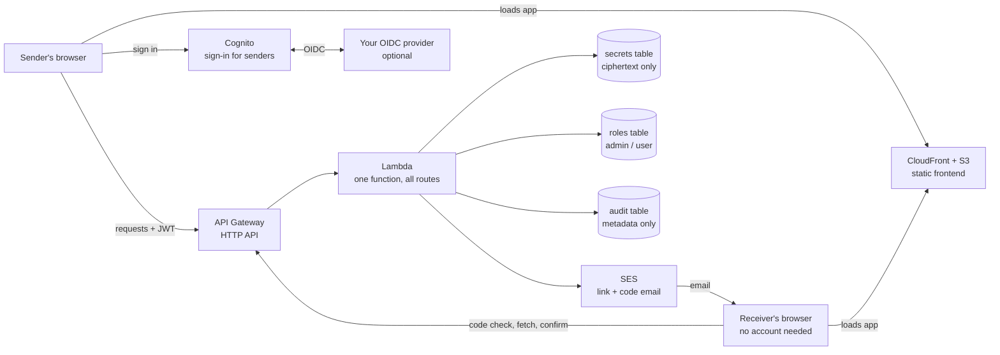

# SecretShare

Zero-knowledge, one-time secret sharing that you host in your own AWS account. Send a
password, API key, token or small file to someone by email. They open it once, with a
one-time code, and then it's gone.

Secrets are encrypted in the sender's browser. The server only ever stores ciphertext,
and the decryption key travels in the link's URL fragment (the part after `#`), which
browsers never send to a server. It runs on serverless AWS for about $0–3 a month.

## Features

- **Client-side encryption.** AES-256-GCM through the browser's built-in Web Crypto API,
  with no third-party crypto library.
- **Email plus one-time code.** The receiver gets a link and a separate 6-digit code.
  They don't need an account.
- **Several recipients.** Send to up to 10 people at once. Each gets their own encrypted
  copy, link and code.
- **Copy the link too.** After sending, copy each link to share in chat as well. The code
  still only goes by email.
- **Burn after read.** A secret is deleted as soon as it's opened, or when it expires
  (you choose between 5 minutes and 7 days).
- **Small files.** Attach a certificate, key or config file up to 150 KB.
- **Flexible sign-in for senders.** Any OIDC provider (Entra ID, Okta, Google Workspace,
  Auth0, Keycloak), open self-sign-up and admin-created local accounts can all run side
  by side. Optional TOTP MFA.
- **History and revoke.** Senders see what they sent and whether it was opened, but
  never the secret itself. They can revoke anything that hasn't been opened yet.
- **Admin page.** Activity log with CSV export, top senders, an optional monthly summary
  email, sign-in settings and user management. The first person to sign in becomes the
  admin.
- **Your branding.** Admins set the name, logo, accent color, support email and a footer
  note. Receivers and emails see it too.
- **Sharing rules.** Limit who can send and who can receive by email domain, cap how long
  links stay available, or turn off attachments. The server enforces them.
- **Open notifications.** Senders can ask to be emailed when their secret is opened.
- **Infrastructure as code.** One Terraform stack. GitHub Actions deploys with OIDC, so
  no AWS keys are stored in the repo.

## How it works



1. The sender writes a secret. Their browser creates a random 256-bit key and encrypts
   the secret with it.
2. The backend stores the ciphertext. It emails the receiver a link, with the key in
   the `#fragment`, and a separate 6-digit code.
3. The receiver opens the link and enters the code. The server hands over the
   ciphertext, the receiver's browser decrypts it, and the server deletes it.

The full security model, including its one deliberate trade-off, is in
[Doc/design.md](Doc/design.md).

## Deploy it

You need an AWS account, Terraform 1.10 or later, Node.js 20 and the AWS CLI. In short:

```bash
cd App-code/backend && npm ci && npm run build && cd ../../Infra
cp terraform.tfvars.example terraform.tfvars   # then fill it in
terraform init -backend-config="bucket=<your-state-bucket>"
terraform apply
# then build the frontend and upload it to S3
```

[Doc/deployment.md](Doc/deployment.md) walks through every step: the state bucket,
email setup, single sign-on, the first admin, GitHub Actions, a custom domain and
teardown.

## Repo layout

```
App-code/frontend/   Vite + TypeScript single-page app, no UI framework, no runtime deps
App-code/backend/    Node.js 20 + TypeScript Lambda, one function for every route
Infra/               Terraform for the whole stack, run locally, never from CI
.github/workflows/   PR checks, manual deploys, release tagging
Doc/                 Design and deployment guides
```

## Cost

At low to moderate volume, most of the stack stays inside the AWS free tier. S3 and
CloudFront cost cents. Lambda, API Gateway and DynamoDB (on-demand) are usually free.
SES costs $0.10 per 1,000 emails, and Cognito's free tier covers a small team. Expect
about **$0–3 a month**. A budget alarm emails you when spend crosses 80% of a monthly
limit you set (default $5).

## Security

Please report vulnerabilities privately. [SECURITY.md](SECURITY.md) explains how. The
threat model and known limitations are in [Doc/design.md](Doc/design.md).

## Contributing

Issues and pull requests are welcome. See [CONTRIBUTING.md](CONTRIBUTING.md).

## License

Copyright 2026 Ananda Raj. Licensed under the [Apache License 2.0](LICENSE).
